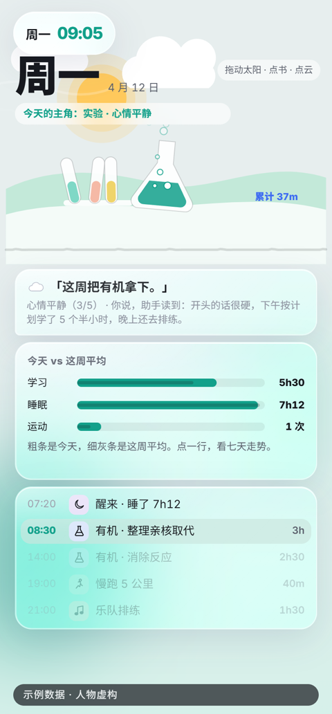
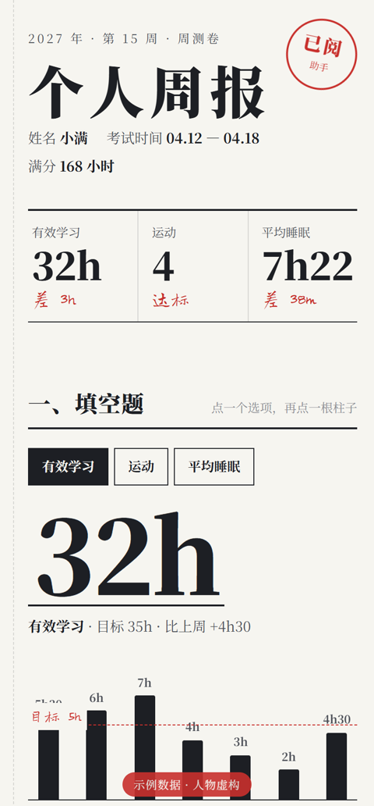

# 个人周报 · weekly-report

**weekly-report** 是一个 AI 助手技能（skill），将一周的日历或文字记录整理为一份可交互的个人周报网页。每份周报依据当周内容选用主题，在手机浏览器中直接打开即可浏览和操作。

本技能遵循开放的 [Agent Skills](https://agentskills.io) 规范（一个文件夹加一份 `SKILL.md`），可用于 Claude、ChatGPT、Codex 及其他支持该规范的工具。

<p>





</p>

> 以上均为示例，人物「林小满」及全部数据为虚构。前三份为同一周套用不同主题的效果。完整页面见 [`examples/`](examples/)，下载 `.html` 文件后用浏览器打开即可。

## 主要特性

1. **沉浸式时间线**
   云白主题以滚动表示时间推进：页面从周一清晨走到周日夜晚。系统为每一天识别一个「主角」活动（考试、实验、跑步、演出等），据此切换当天的色调、场景插画、转场动画与数据面板；情绪偏低的日子以天气变化呈现。

2. **按周选择主题**
   主题由当周内容决定，而非固定模板。内置五套主题，覆盖考试周、演出周、项目冲刺周等常见情形，也可以复制现有主题自行扩展。

3. **可交互的数据可视化**
   核心数据、时间分配、目标完成度均以动画呈现：数字递增、进度条与圆环逐步填满、折线逐段绘出。时间线支持拖动查看任意时刻，热力图、图例与卡片均可点击查看明细。

4. **成就配图**
   每项成就配有对应的矢量插图，例如跑步配速曲线、考试分数轴、练习节拍阶梯。

5. **情绪曲线与解读标注**
   助手依据当天的原话与活动描绘一周情绪起伏，并在页面上注明「由助手解读」；用户本人打分的日期以本人评分为准。

6. **数据如实呈现**
   缺少记录的部分保留为空，不做推测或补全；引用内容均为用户原话。

7. **单文件、本地生成**
   脚本仅依赖 Python 标准库，在本地运行，输出单个 `.html` 文件，便于保存与分享。

## 内置主题

| 主题 | 适用场景 | 风格 |
|---|---|---|
| `cloud` 云白（默认） | 任意一周 | 沉浸式滚动叙事，每天按主角切换场景 |
| `swiss` 编辑部 | 任意一周，数据较多时 | 瑞士风格版式，冷静清晰 |
| `exam` 考卷 | 考试周、测验较多的一周 | 批改过的试卷 |
| `vinyl` 唱片 | 演出、排练、创作为主的一周 | 唱片封套与调音台 |
| `terminal` 终端 | 编程、项目冲刺的一周 | 浅色编辑器与终端 |

## 安装

技能本体为 `weekly-report/` 文件夹，放入所用工具的技能目录即可：

| 工具 | 安装方式 |
|---|---|
| Claude Code | `cp -r weekly-report ~/.claude/skills/` |
| claude.ai | 将 `weekly-report` 文件夹压缩为 zip，在设置的 Skills 中上传 |
| Codex（OpenAI） | 放入项目的 `.agents/skills/` 或 `~/.codex/skills/` |
| ChatGPT（已开通 Skills） | 将 `weekly-report` 压缩为 zip，在 Skills 中上传 |
| 其他支持 Agent Skills 的工具 | 按其文档放入技能目录 |
| ChatGPT 自定义 GPT（未开通 Skills） | 见下文「在自定义 GPT 中使用」 |

**运行环境**：Python 3.9 及以上，无需安装第三方包。

## 使用方法

向助手发送：

> 出这周的周报。

并提供本周记录，支持以下三种形式：

| 输入 | 说明 |
|---|---|
| 日历导出的 `.ics` 文件 | 推荐。如日历已按类别区分，可分别导出学习、运动、睡眠等日历 |
| 已连接的日历 | 助手可通过连接器、插件或接口读取日历时，直接读取 |
| 一段文字记录 | 本周做了什么、几点入睡等，助手只整理可以确定的内容 |

助手会询问一次本周目标（用于目标对账）和希望收录的原话，随后生成 `.html` 文件。

### 示例

仓库提供一份虚构的示例日历 [`examples/week-midterm.ics`](examples/week-midterm.ics)。安装技能后，将其发送给助手并说「出这周的周报」，即可体验完整流程。

## 命令行用法

不通过助手时，也可以直接运行脚本：

```bash
# 1. 将 .ics 转换为周数据
python weekly-report/scripts/ics_to_week.py 我的日历.ics --week-start 2027-04-12 -o week.json

# 2. 补充成就、评价等内容后，生成网页
python weekly-report/scripts/build.py week.json weekly-report/themes/cloud -o 周报.html
```

`week.json` 的字段说明见 [references/data.md](weekly-report/references/data.md)，内容写作规范见 [references/writing.md](weekly-report/references/writing.md)。生成前脚本会校验数据，并以中文列出问题。

## 在自定义 GPT 中使用

未开通 Skills 功能时，可以创建一个自定义 GPT：

1. 新建 GPT，将 [`adapters/chatgpt/instructions.md`](adapters/chatgpt/instructions.md) 的内容粘贴到「指令」；
2. 将 `weekly-report` 文件夹压缩为 zip，上传到「知识」；
3. 开启「代码解释器」。

之后发送「出这周的周报」，GPT 会解压文件、整理数据、运行 `build.py`，并提供可下载的 `.html`。

## 自定义主题

复制 `weekly-report/themes/` 下的任一主题文件夹，修改 `theme.json`、`theme.css`、`theme.js` 三个文件即可。设计原则与交付前检查清单见 [references/design.md](weekly-report/references/design.md)。

## 目录结构

```text
weekly-report/            技能本体
├── SKILL.md              助手执行步骤
├── scripts/              build.py（校验并生成网页）、ics_to_week.py（日历转换）
├── assets/               所有主题共用的页面组件
├── themes/               五套内置主题
└── references/           数据格式、写作规范、设计规范
examples/                 示例数据（虚构）与生成的示例页面
adapters/chatgpt/         自定义 GPT 的指令
tests/                    脚本测试
tools/                    截图、交互与离线检查工具（开发用）
video/                    宣传视频与封面的制作脚本（开发用）
```

## 开发与测试

```bash
python -m unittest discover tests                         # 脚本测试
cd tools && npm install && cd ..                          # 安装检查工具（可选）
node tools/shoot.mjs examples/cloud.html out/shots 400    # 逐屏截图，检查横向滚动与报错
node tools/interact.mjs examples/cloud.html               # 逐一触发页面交互
node tools/offline.mjs examples/cloud.html                # 断网条件下检查页面
```

## 隐私说明

- 记录的整理与网页的生成均在本地或你所使用的助手中完成；生成的网页为独立文件，不会上传任何内容。
- 网页打开时会从公共 CDN（Google Fonts、jsDelivr）加载字体与动画库。断网时页面仍可完整阅读，届时使用系统字体，沉浸式主题退回静态版本。

## 致谢

- [GSAP](https://gsap.com)：沉浸式主题的动画库，按其免费许可原样引用
- [霞鹜文楷 LXGW WenKai](https://github.com/lxgw/LxgwWenKai)：原话卡片字体（SIL OFL 1.1）
- [Google Fonts](https://fonts.google.com)：其余字体
- [Hallmark](https://github.com/Nutlope/hallmark)：交付前检查的分级方法参考

## 许可证

本仓库的代码与文档采用 [MIT 许可证](LICENSE)。第三方库与字体遵循各自的许可证。
