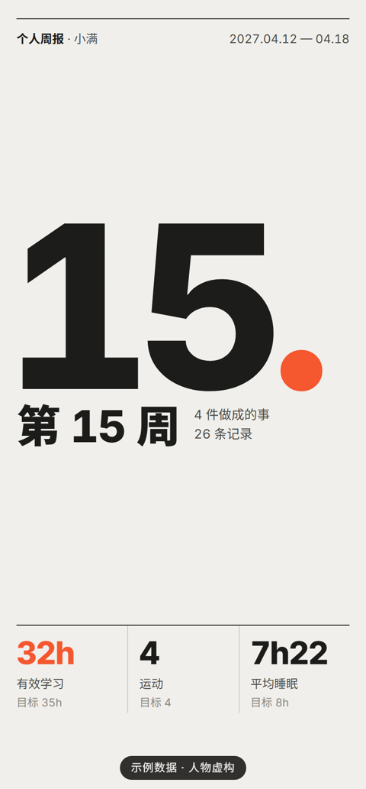
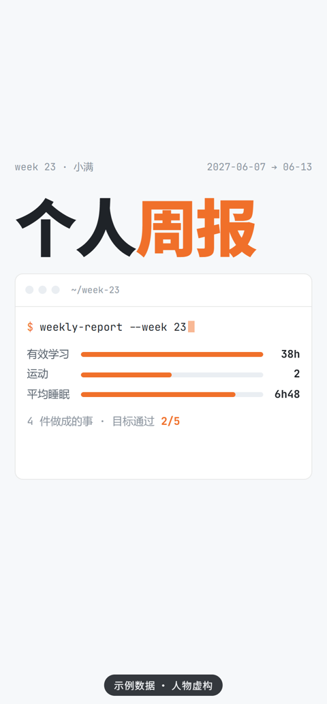

# 个人周报 · weekly-report

一个 AI 助手用的 skill：把你这一周的记录，做成一份**每周换主题**、手机上好看、可以点的周报网页。

按开放的 [Agent Skills](https://agentskills.io) 格式写成（一个文件夹 + `SKILL.md`），Claude、ChatGPT、Codex 和其他支持这个格式的工具都能装；不支持 skill 的地方也能用：见下面的「在 ChatGPT 的 GPT 里用」和「自己动手跑」。

<p>





</p>

上面几份都是**示例**：人物「林小满」和数据都是虚构的。前三份是同一周换了三个主题。云白是沉浸版：往下滑，时钟从周一早上走到周日晚上，每天按当天的主角换色调和场景。下载 [`examples/`](examples/) 里的 `.html`，用手机或电脑浏览器打开就能点着看。

## 它和别的周报有什么不一样

- **滑动就是这一周在过去**（云白）：每天有一个主角（考试、实验、跑步、演出……），色调、小场景、转场和数据面板都跟着换；心情低的那天会下雨。
- **每周一个主题**：考试周是一张批改过的考卷，演出周是一张唱片，写代码的一周是一个终端，任何一周都可以排成瑞士风格的编辑部版面。主题从这周的内容里长出来，不是套模板换数字。
- **数据会动、能点**：数字从 0 滚到终值，柱子长出来，线一笔画出来；时间线可以按住拖，看任何一刻在做什么；热力格点一下看那一小时。
- **成就有自己的小画**：跑步画配速线，考试画分数轴，练琴画节拍器的台阶。
- **情绪是读出来的**：助手读你当天说的话和做的事，画出一周的起伏，并标明这是它的读法。
- **不编数据**：没有记录的地方留空。

## 安装

skill 就是 `weekly-report/` 这个文件夹。放到你用的工具认得的位置：

| 工具 | 怎么装 |
|---|---|
| Claude Code | `cp -r weekly-report ~/.claude/skills/` |
| claude.ai | 把 `weekly-report` 文件夹打成 zip，在设置的 Skills 里上传 |
| Codex（OpenAI） | 放进项目的 `.agents/skills/`（或 `~/.codex/skills/`） |
| ChatGPT（有 Skills 的账号） | 把 `weekly-report` 打成 zip，在 Skills 里上传 |
| 其他支持 Agent Skills 的工具 | 按它的文档放到 skills 目录 |
| ChatGPT 的 GPT（没有 Skills） | 见下面「在 ChatGPT 的 GPT 里用」 |

运行时需要 Python 3.9 以上（只用标准库）。沉浸版主题用到 GSAP 动画库：找不到本地文件时页面会从 jsDelivr 加载固定的 3.15.0 版，所以第一次打开要联网。

## 用法

对助手说：

> 出这周的周报。

然后给它这周的记录，三种都行：

1. **日历导出的 `.ics` 文件**（最省事）。日历分了类可以分别导出：学习、运动、睡眠。
2. **连上日历**：助手能读你的日历（连接器、插件或接口）时直接读。
3. **一段文字**：把这周干了什么、几点睡的贴给它。

它会问一次这周的目标是什么，然后出一个 `.html` 文件，手机浏览器直接打开。

## 先试一试

仓库里有一份示例日历 [`examples/week-midterm.ics`](examples/week-midterm.ics)（虚构的一周）。装好 skill 后，把它发给助手，说「出这周的周报」就行。

不用助手也可以先看看数据长什么样：

```bash
python weekly-report/scripts/ics_to_week.py examples/week-midterm.ics --week-start 2027-04-12
```

## 在 ChatGPT 的 GPT 里用

没有 Skills 功能时，可以做一个自己的 GPT：

1. 新建 GPT，把 [`adapters/chatgpt/instructions.md`](adapters/chatgpt/instructions.md) 的内容贴进「指令」；
2. 把 `weekly-report` 文件夹打成 zip，上传到「知识」；
3. 打开「代码解释器」。

之后对它说「出这周的周报」，它会解压 zip、整理数据、运行 `build.py`，给你一个可以下载的 `.html`。

## 自己动手跑

```bash
# .ics → 数据
python weekly-report/scripts/ics_to_week.py 我的日历.ics --week-start 2027-04-12 -o week.json
# （补上成就、评价等内容后）数据 + 主题 → 网页
python weekly-report/scripts/build.py week.json weekly-report/themes/exam -o 周报.html
```

`week.json` 的格式见 [weekly-report/references/data.md](weekly-report/references/data.md)。

## 做一个新主题

复制 `weekly-report/themes/` 下任意一个文件夹，改三个文件。做法见 [weekly-report/references/design.md](weekly-report/references/design.md)。

## 开发

```bash
python -m unittest discover tests        # 脚本测试
cd tools && npm install                  # 截图检查和视频工具（可选）
node tools/shoot.mjs examples/exam.html out/shots 400
```

## 隐私

数据只在你和你的助手之间：脚本在本地运行，生成的网页是一个单独的文件，不会把内容上传到任何地方。
打开网页时会从公共 CDN 加载字体和动画库（Google Fonts、jsDelivr），离线时页面照样能看，只是换成系统字体、少一些动效。

## 致谢

- 动画：[GSAP](https://gsap.com)（沉浸版主题用，按它的免费许可原样引用，不修改）
- 原话卡的字体：[霞鹜文楷 LXGW WenKai](https://github.com/lxgw/LxgwWenKai)（SIL OFL 1.1）
- 其余字体来自 [Google Fonts](https://fonts.google.com)
- 交付前检查的分档办法参考了 [Hallmark](https://github.com/Nutlope/hallmark)

## 许可

代码和文档：MIT。上面列出的第三方库和字体按它们各自的许可使用。
